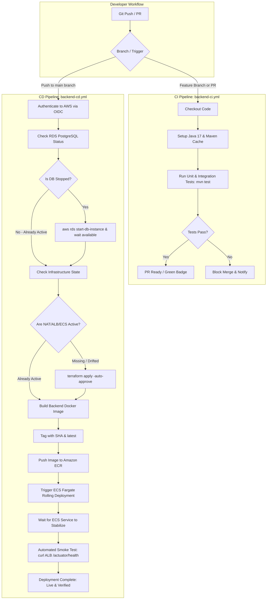

Absolutely. Let's make this the **single master deployment plan** for Atithi so we don't keep jumping between steps.

Below is the complete path from **local Spring Boot project → AWS → production**, with the **current status** of each stage.

# Atithi AWS Deployment — Complete Plan

### Target architecture

```text
                         Internet
                            │
                            ▼
                    ┌────────────────┐
                    │  Route 53/DNS  │
                    └───────┬────────┘
                            │
                            ▼
                    ┌────────────────┐
                    │      ALB       │
                    │ HTTP / HTTPS   │
                    └───────┬────────┘
                            │
                            ▼
              ┌──────────────────────────┐
              │       ECS Fargate        │
              │                          │
              │   atithi-server          │
              │   Spring Boot :8080      │
              └────────────┬─────────────┘
                           │
                           ▼
                  ┌─────────────────┐
                  │   RDS Postgres  │
                  │  Private subnet │
                  └─────────────────┘

                 Supporting services
                 ───────────────────
                 ECR
                 Secrets Manager
                 CloudWatch
                 IAM
                 VPC
                 NAT Gateway
```

---

# Phase 1 — Terraform foundation

### 1. Terraform provider/configuration

```text
Terraform
    │
    └── AWS provider
        └── ap-south-1
```

**Status: ✅ COMPLETE**

---

# Phase 2 — VPC/networking

We created:

```text
VPC
│
├── Public Subnet 1
├── Public Subnet 2
│
├── Private App Subnet 1
├── Private App Subnet 2
│
├── Private DB Subnet 1
└── Private DB Subnet 2
```

Also:

- Internet Gateway
- NAT Gateway
- Elastic IP
- Public route table
- Private app route table
- Private DB route table
- Subnet associations

Your current resources:

```text
VPC
vpc-058c5dd8e8c8dbfdb

NAT Gateway
nat-002ef06ef28a53f1c

Public:
subnet-08c73a8fa7227dd84
subnet-04dde8233665246e1

Private App:
subnet-079397bbbde4c4216
subnet-0f7eceb14411ab9ee

Private DB:
subnet-0636eef1de012095f
subnet-05e0ee1cd4952cda1
```

**Status: ✅ COMPLETE**

---

# Phase 3 — Security Groups

We created three security groups:

```text
ALB SG
   │
   └── HTTP/HTTPS from Internet

ECS SG
   │
   └── Traffic from ALB

RDS SG
   │
   └── PostgreSQL from ECS
```

This is the intended security flow:

```text
Internet
   │
   ▼
ALB
   │
   ▼
ECS
   │
   ▼
RDS
```

Not:

```text
Internet ──────────────► RDS ❌
```

**Status: ✅ COMPLETE**

---

# Phase 4 — IAM

We created:

### ECS Task Role

```text
atithi-dev-ecs-task-role
```

### ECS Task Execution Role

```text
atithi-dev-ecs-task-execution-role
```

And attached:

```text
AmazonECSTaskExecutionRolePolicy
```

The execution role is used by ECS to do things such as:

- pull images from ECR
- send logs to CloudWatch
- interact with required AWS services

**Status: ✅ COMPLETE**

---

# Phase 5 — ECR

Terraform created:

```text
ECR Repository
atithi-server
```

Repository:

```text
551626543871.dkr.ecr.ap-south-1.amazonaws.com/atithi-server
```

Terraform configuration also has:

```text
scan_on_push = true
encryption = AES256
```

**Status: ✅ ECR REPOSITORY COMPLETE**

But:

```text
ECR image
❌ NOT YET COMPLETE
```

You built the Docker image locally successfully:

```text
atithi-server:latest
```

And tagged it correctly:

```text
551626543871.dkr.ecr.ap-south-1.amazonaws.com/atithi-server:latest
```

Your push was started, but you stopped it.

So:

```text
Local Docker image       ✅
ECR repository           ✅
Image completely pushed  ❌
```


---

# Phase 6 — ECS Cluster

Terraform created:

```text
atithi-dev-cluster
```

This is the ECS Fargate cluster.

**Status: ✅ COMPLETE**

---

# Phase 7 — ECS Task Definition

Terraform created:

```text
atithi-dev-app
```

Current configuration:

```text
Fargate
CPU:    512
Memory: 1024 MB
Port:   8080
```

Container:

```text
atithi-server
```

Image:

```text
551626543871.dkr.ecr.ap-south-1.amazonaws.com/atithi-server:latest
```

Task execution role:

```text
atithi-dev-ecs-task-execution-role
```

Task role:

```text
atithi-dev-ecs-task-role
```

**Status: ✅ COMPLETE**

Important:

The task definition exists, but **we haven't actually launched an ECS service/task yet.**

---

# Phase 8 — CloudWatch

Your task definition currently references:

```text
/ecs/atithi-dev
```

as the CloudWatch log group.

Defined in `cloudwatch.tf`:

```hcl
resource "aws_cloudwatch_log_group" "ecs" {
  name              = "/ecs/atithi-dev"
  retention_in_days = 7

  tags = {
    Name = "${local.name_prefix}-ecs-logs"
  }
}
```

Applied and verified in AWS CloudWatch (`/ecs/atithi-dev`).

**Status: ✅ COMPLETE**

---

# Phase 9 — Application Docker image

Your Dockerfile is working.

You successfully executed:

```text
docker build -t atithi-server .
```

and the build completed successfully.

Your image contains:

```text
Spring Boot
Java 17
Maven build
```

Your multi-stage Docker build is working.

**Status: ✅ COMPLETE**

---

# Phase 10 — Push image to ECR

```text
Docker image
     │
     ▼
ECR
     │
     ▼
atithi-server:latest
```

Verified via:
```powershell
aws ecr describe-images --repository-name atithi-server --region ap-south-1
```

ECR image: ✅ COMPLETE (tag: `latest`, size: 222 MB)

**Status: ✅ COMPLETE**

---

# Phase 11 — Application Load Balancer

This is where we currently haven't gone far enough.

You said:

> ALB is not empty.

Correct.

Once check the **ALB security group**, the complete ALB infrastructure.

We need:

```text
aws_lb
    │
    ├── Public subnet 1
    └── Public subnet 2
```

Then:

```text
aws_lb_target_group
```

For example:

```text
Port: 8080
Protocol: HTTP
Target type: ip
```

Then:

```text
aws_lb_listener
```

Initially:

```text
HTTP : 80
      │
      ▼
Target Group
      │
      ▼
ECS Service
```

Later:

```text
HTTPS : 443
      │
      ▼
Target Group
      │
      ▼
ECS
```

**Status: ✅ COMPLETE**

ALB, Target Group, and HTTP Listener created and verified in AWS:
- ALB DNS: `atithi-dev-alb-1340411201.ap-south-1.elb.amazonaws.com`
- Target Group: `arn:aws:elasticloadbalancing:ap-south-1:551626543871:targetgroup/atithi-dev-app-tg/db2089ec4881f42a`
- Port 80 Listener: forwarding traffic to the target group.

---

# Phase 12 — ECS Service

We currently have:

```text
ECS Cluster        ✅ (in AWS state)
Task Definition    ✅ (in AWS state)
ECR Repository     ✅ (in AWS state)
ECR Image          ❌ (not pushed yet)
```

And:

```text
aws_ecs_service    📝 (defined in ecs.tf, but not applied to AWS yet)
```

The service definition in `ecs.tf` will:

- launch Fargate tasks with `atithi-dev-app` definition
- place them in private app subnets
- attach ECS security group
- connect them to ALB target group
- maintain desired task count (1)

**Status: 📝 CODE DRAFTED IN `ecs.tf` (Pending CloudWatch + ECR Image Push + `terraform apply`)**

---

# Phase 13 — ALB → ECS integration

Once ALB + ECS Service exist:

```text
Internet
   │
   ▼
ALB :80
   │
   ▼
Target Group
   │
   ▼
ECS Fargate
   │
   ▼
Spring Boot :8080
```

We configure the ECS service with:

```text
load_balancer {
    target_group_arn = aws_lb_target_group.app.arn
    container_name   = "atithi-server"
    container_port   = 8080
}
```

And configure ECS health checks:

```text
/actuator/health
```

**Status: ✅ COMPLETE**

*Verification note*: Target Group is `healthy` on port 8080. ALB endpoint `http://atithi-dev-alb-1340411201.ap-south-1.elb.amazonaws.com/actuator/health` and `/health` return HTTP 200 `status: UP`.

---

# Phase 14 — RDS PostgreSQL

Your Terraform currently has:

```text
RDS Security Group
```

but the actual database isn't part of this deployment yet.

We need:

```text
aws_db_subnet_group
```

using:

```text
Private DB subnet 1
Private DB subnet 2
```

Then:

```text
aws_db_instance
```

Conceptually:

```text
ECS
 │
 │ PostgreSQL :5432
 ▼
RDS
```

And importantly:

```text
Internet ─────X────► RDS
```

RDS stays private.

**Status: ✅ COMPLETE**
- Created `aws_db_subnet_group.db` across private DB subnets
- Created `aws_db_instance.postgres` (PostgreSQL 16, db.t4g.micro, private)
- Endpoint: `atithi-dev-postgres.cba6qwgmytsm.ap-south-1.rds.amazonaws.com:5432`
- Status: `available`

---

# Phase 15 — Secrets Manager

We should **not put database passwords directly into Terraform files or GitHub**.

We created:

```text
AWS Secrets Manager
        │
        └── atithi-dev-db-credentials (username, password, database)
```

**Status: ✅ COMPLETE**
- Secret: `atithi-dev-db-credentials`
- ARN: `arn:aws:secretsmanager:ap-south-1:551626543871:secret:atithi-dev-db-credentials-7l6XRW`

---

# Phase 16 — ECS → RDS

Once RDS and Secrets Manager are ready:

```text
ECS
 │
 │ 5432
 ▼
RDS PostgreSQL
```

The ECS security group will be allowed to access:

```text
RDS SG : 5432
```

**Status: ✅ COMPLETE**
- ECS Fargate tasks securely connect to private RDS PostgreSQL on port 5432.
- Database credentials injected via AWS Secrets Manager.
- Hibernate schema initialized, tables verified, and background jobs running.

---

# Phase 17 — HTTPS

After HTTP works, we'll add:

```text
ACM Certificate
```

Then:

```text
Internet
    │
    ▼
HTTPS :443
    │
    ▼
ALB
    │
    ▼
ECS
```

HTTP:

```text
:80 → redirect → :443
```

HTTPS:

```text
:443 → ECS
```

**Status: ❌ NOT IMPLEMENTED**

---

# Phase 18 — Domain / DNS

If you're using your own domain:

```text
api.yourdomain.com
```

DNS:

```text
Route 53
    │
    ▼
ALB
```

Then your API becomes something like:

```text
https://api.example.com
```

instead of:

```text
http://xxxxxxxx.ap-south-1.elb.amazonaws.com
```

**Status: ❌ NOT IMPLEMENTED**

---

# Phase 19 — Application configuration

Spring Boot needs production configuration.

For example:

```text
SPRING_DATASOURCE_URL
SPRING_DATASOURCE_USERNAME
SPRING_DATASOURCE_PASSWORD
```

plus your other Atithi configuration.

We'll move sensitive values into:

```text
Secrets Manager
```

and non-sensitive configuration into ECS environment variables where appropriate.

**Status: ⏳ NOT IMPLEMENTED**

---

# Phase 20 — GitHub Actions CI/CD

After manual deployment works, we automate it.

Target pipeline:

```text
Developer
    │
    ▼
git push
    │
    ▼
GitHub
    │
    ▼
GitHub Actions
    │
    ├── Build
    ├── Test
    ├── Docker build
    ├── AWS authentication via OIDC
    ├── Login to ECR
    ├── Push image
    └── Deploy ECS
             │
             ▼
         ECS Service
```

No AWS access key/secret key stored in GitHub.

We'll use the IAM OIDC role you've already been working on.

**Status: ⏳ PARTIALLY PREPARED / NOT FINALIZED**

---

# Phase 21 — Deployment strategy

Eventually, your deployment becomes:

```text
git push
   │
   ▼
GitHub Actions
   │
   ▼
Docker build
   │
   ▼
ECR
   │
   ▼
ECS new task definition
   │
   ▼
ECS Service rolling deployment
   │
   ▼
ALB
   │
   ▼
Users
```

**Status: ❌ NOT IMPLEMENTED**

---

# Phase 22 — Monitoring

We'll configure:

```text
CloudWatch Logs
        │
        ├── ECS application logs
        └── ECS service logs
```

And potentially:

```text
CloudWatch Alarms
        │
        ├── ECS CPU
        ├── ECS memory
        ├── ALB 5xx
        └── Target health
```

**Status: ❌ NOT IMPLEMENTED**

---

# Phase 23 — Production hardening

Before calling the deployment production-ready:

### Network

```text
RDS private
ECS private
ALB public
```

### Security

```text
Internet
   │
   ▼
ALB
   │
   ▼
ECS
   │
   ▼
RDS
```

No:

```text
Internet → RDS ❌
Internet → ECS directly ❌
```

### Secrets

```text
Secrets Manager
```

not Git.

### IAM

Least privilege wherever practical.

### HTTPS

Required for production.

### Database

Automated backups enabled.

### ECS

Health checks + service deployment configuration.

---

# Complete status right now

Here's the important part.

| Component | Status | State / Verification |
|---|---|---|
| AWS Account & CLI | ✅ COMPLETE | Account ID `551626543871`, Region `ap-south-1` |
| Terraform Foundation | ✅ COMPLETE | State verified (`v1.15.8`, AWS provider `v6.69.1`) |
| VPC & Gateways | ✅ COMPLETE | VPC `vpc-058c5dd8e8c8dbfdb`, IGW, NAT `nat-002ef06ef28a53f1c` |
| Subnets & Route Tables | ✅ COMPLETE | 2 Public, 2 Private App, 2 Private DB subnets & routes |
| Security Groups | ✅ COMPLETE | ALB SG, ECS SG, RDS SG |
| IAM Roles & Policies | ✅ COMPLETE | Task Role & Execution Role + policy attached |
| ECR Repository | ✅ COMPLETE | `atithi-server` created |
| Spring Boot Dockerfile | ✅ COMPLETE | Multi-stage Temurin-17 JRE Dockerfile |
| Local Docker Image Build | ✅ COMPLETE | `atithi-server:latest` built locally |
| ECR Image Push | ✅ COMPLETE | Image tagged 'latest' active in ECR (222 MB) |
| CloudWatch Log Group | ✅ COMPLETE | `/ecs/atithi-dev` active (retention 7 days) |
| ECS Cluster | ✅ COMPLETE | `atithi-dev-cluster` active in AWS |
| ECS Task Definition | ✅ COMPLETE | `atithi-dev-app:1` registered in AWS |
| Application Load Balancer | ✅ COMPLETE | `atithi-dev-alb-1340411201.ap-south-1.elb.amazonaws.com` |
| ALB Target Group | ✅ COMPLETE | `atithi-dev-app-tg` (:8080, `/actuator/health`) |
| ALB HTTP Listener | ✅ COMPLETE | Port 80 forward to Target Group |
| ECS Service | ✅ COMPLETE | `atithi-dev-service` active in AWS ECS |
| ECS Service Running Task | ✅ COMPLETE | Task running on Fargate (`atithi-dev-app:2`), connected to RDS PostgreSQL, healthy |
| ALB → ECS End-to-End API | ✅ COMPLETE | ALB returns HTTP 200 on `/actuator/health` and `/health` |
| RDS PostgreSQL | ✅ COMPLETE | `atithi-dev-postgres.cba6qwgmytsm.ap-south-1.rds.amazonaws.com` (available) |
| Secrets Manager | ✅ COMPLETE | `atithi-dev-db-credentials` (username, password, database) |
| ECS → RDS Connectivity | ✅ COMPLETE | Hibernate connected, DDL verified, background jobs active |
| HTTPS / ACM Certificate | ❌ NOT IMPLEMENTED | Phase 5 |
| Route 53 / Custom Domain | ❌ NOT IMPLEMENTED | Phase 5 |
| GitHub Actions CI/CD (OIDC) | ❌ NOT IMPLEMENTED | Phase 5 |
| CloudWatch Alarms & Metrics | ❌ NOT IMPLEMENTED | Phase 5 |
| Production Hardening | ❌ NOT IMPLEMENTED | Phase 5 |

---

# Master Deployment Checklist

### Phase 1: Foundation & Networking (Completed)
- [x] Configure AWS Provider & Terraform state in `ap-south-1`
- [x] Create VPC (`10.0.0.0/16`)
- [x] Create 2 Public Subnets, 2 Private App Subnets, 2 Private DB Subnets
- [x] Create Internet Gateway, EIP, and NAT Gateway
- [x] Create Public & Private Route Tables and associations
- [x] Create ALB Security Group (inbound 80, 443; outbound all)
- [x] Create ECS Security Group (inbound 8080 from ALB SG; outbound all)
- [x] Create RDS Security Group (inbound 5432 from ECS SG; outbound all)
- [x] Create ECS Task Execution Role & attach `AmazonECSTaskExecutionRolePolicy`
- [x] Create ECS Task Role
- [x] Create ECR Repository `atithi-server`
- [x] Create ECS Fargate Cluster `atithi-dev-cluster`
- [x] Register ECS Task Definition `atithi-dev-app:1`
- [x] Build local Docker image `atithi-server:latest`

---

### Phase 2: Logging & Container Registry (Completed)
- [x] **Step 2.1: Implement CloudWatch Log Group in `cloudwatch.tf`**
  - [x] Add `aws_cloudwatch_log_group.ecs` (`name = "/ecs/atithi-dev"`, `retention_in_days = 7`)
  - [x] Run `terraform plan` and `terraform apply -target="aws_cloudwatch_log_group.ecs"`
  - [x] Verify log group exists in AWS CloudWatch (`/ecs/atithi-dev`)
- [x] **Step 2.2: Authenticate and Push Docker Image to ECR**
  - [x] Authenticate Docker with AWS ECR (`aws ecr get-login-password`)
  - [x] Tag local image `atithi-server:latest` with ECR repository URI
  - [x] Push image to ECR repository (`551626543871.dkr.ecr.ap-south-1.amazonaws.com/atithi-server:latest`)
  - [x] Verify image is listed via `aws ecr describe-images`

---

### Phase 3: Application Load Balancer & ECS Service Deployment (Completed)
- [x] **Step 3.1: Apply Application Load Balancer (`alb.tf`)**
  - [x] Review `alb.tf` resources: `aws_lb.main`, `aws_lb_target_group.app`, `aws_lb_listener.http`
  - [x] Run `terraform plan` and `terraform apply` targeting ALB resources
  - [x] Verify ALB DNS name (`atithi-dev-alb-1340411201.ap-south-1.elb.amazonaws.com`)
- [x] **Step 3.2: Launch ECS Service (`ecs.tf`)**
  - [x] Review `aws_ecs_service.app` in `ecs.tf`
  - [x] Run `terraform apply -target="aws_ecs_service.app"`
  - [x] Verify ECS task transitions from `PROVISIONING` → `RUNNING`
  - [x] Check container logs in CloudWatch `/ecs/atithi-dev` (Verified Spring Boot v4.1.1 and Tomcat initialize on :8080)
- [x] **Step 3.3: Verify ALB → ECS Connectivity (Completed)**
  - [x] Target Group target health verified: `healthy` on port 8080
  - [x] ALB public URL probe verified: HTTP 200 on `/actuator/health` and `/health`

---

### Phase 4: Database & Secrets Infrastructure (Completed)
- [x] **Step 4.1: Configure AWS Secrets Manager (`secrets.tf`)**
  - [x] Define random password / secrets for database credentials and JWT secret
  - [x] Apply `secrets.tf` (Secret: `atithi-dev-db-credentials`)
- [x] **Step 4.2: Configure RDS PostgreSQL Subnet Group and Instance (`rds.tf`)**
  - [x] Create `aws_db_subnet_group` using private DB subnets
  - [x] Create `aws_db_instance` (PostgreSQL 16, db.t4g.micro, private, non-publicly accessible)
  - [x] Apply `rds.tf` and verify DB endpoint (`atithi-dev-postgres.cba6qwgmytsm.ap-south-1.rds.amazonaws.com:5432`, status: `available`)
- [x] **Step 4.3: Inject Secrets into ECS Task Definition (`iam.tf`, `ecs.tf`)**
  - [x] Add IAM policy attachment in `iam.tf` granting ECS Task Execution Role `SecretsManagerReadWrite`
  - [x] Update ECS task definition in `ecs.tf` with environment (`DB_HOST`, `DB_PORT`, `DB_NAME`) and secrets (`DB_USERNAME`, `DB_PASSWORD`)
  - [x] Run `terraform apply` targeting IAM and ECS task definition (Revision: `atithi-dev-app:2`)
  - [x] Verify ECS task connects to RDS, starts cleanly, and passes ALB target health checks

---

### Phase 5: Production Hardening, HTTPS & CI/CD (Next Focus)
- [ ] **Step 5.1: Custom Domain & HTTPS**
  - [ ] Request/validate ACM certificate
  - [ ] Add HTTPS listener (port 443) on ALB & configure HTTP to HTTPS redirect
  - [ ] Point Route 53 A record (alias) to ALB
- [ ] **Step 5.2: GitHub Actions CI/CD Pipeline**
  - [ ] Configure AWS IAM OIDC identity provider for GitHub repository
  - [ ] Create `.github/workflows/deploy.yml` for automated build, test, push, and rolling update
- [ ] **Step 5.3: Monitoring & Alarms**
  - [ ] Configure CloudWatch alarms for ECS CPU/Memory and ALB 5XX responses

---

# Strict Operating Protocol & Confirmation Rules

To prevent accidental resource conflicts, premature deployments, or runaway states:

1. **Strictly Phase-by-Phase**:
   - Implementation MUST proceed strictly one phase at a time.
   - Do NOT execute or bundle changes for future phases prematurely.
2. **Mandatory User Confirmation**:
   - Before applying any Terraform code or executing AWS/Docker commands, the plan for that specific phase must be presented.
   - The agent MUST pause and wait for the user's explicit confirmation before proceeding to execution.
3. **Verification After Every Step**:
   - After applying changes for a step, verify the resource using AWS CLI or Terraform status.
   - Update this `plan.md` checklist with `[x]` upon verification.
4. **Current Phase**:
   - **Phase 5 — Production Hardening, HTTPS & CI/CD**.

---

# Operations & Diagnostics Quick Reference

This section provides verified, copy-paste instructions for accessing the private live database and monitoring real-time logs via both AWS CLI and the AWS Management Console (GUI).

---

## 1. How to Check the Live Database (PostgreSQL RDS)

Because the RDS instance is placed in private subnets with no public internet ingress, direct connections from outside the VPC are blocked for security. Use one of the verified methods below:

### Method A: Run Live SQL Queries in 1 Command (Recommended)

A helper script [`run-db-query.ps1`](file:///d:/resource/Projects/Hostel%20Management/aavas/terraform/run-db-query.ps1) has been created. It runs a secure, one-off Fargate task inside your VPC using the registered task definition `atithi-dev-db-client:1` and prints query results directly to your terminal:

```powershell
# Navigate to terraform directory
cd "d:\resource\Projects\Hostel Management\aavas\terraform"

# 1. List all database tables:
powershell -ExecutionPolicy Bypass -File .\run-db-query.ps1 "\dt"

# 2. Check user table count:
powershell -ExecutionPolicy Bypass -File .\run-db-query.ps1 "SELECT count(*) FROM users;"

# 3. View table records:
powershell -ExecutionPolicy Bypass -File .\run-db-query.ps1 "SELECT id, email, role, status FROM users LIMIT 10;"

# 4. Describe table schema:
powershell -ExecutionPolicy Bypass -File .\run-db-query.ps1 "\d users"
```

### Method B: Native AWS CLI Command (Without Script)

You can run any SQL statement directly using standard AWS CLI:

```bash
# 1. Start a one-off query task in the private VPC subnet:
aws ecs run-task \
  --cluster "atithi-dev-cluster" \
  --task-definition "atithi-dev-db-client:1" \
  --launch-type "FARGATE" \
  --network-configuration "awsvpcConfiguration={subnets=[subnet-079397bbbde4c4216],securityGroups=[sg-00043f8ddcad6687e],assignPublicIp=DISABLED}" \
  --overrides '{"containerOverrides":[{"name":"db-client","command":["psql","-c","SELECT table_name FROM information_schema.tables WHERE table_schema='\''public'\'';"]}]}' \
  --region "ap-south-1"

# 2. View the query output from CloudWatch (replace <TASK_ID> with the task ID from the output above):
aws logs get-log-events \
  --log-group-name "/ecs/atithi-dev" \
  --log-stream-name "db-client/db-client/<TASK_ID>" \
  --region "ap-south-1" \
  --query "events[].message" \
  --output text
```

### Method C: Inspect Live DB Credentials (Secrets Manager)

To check the active database credentials stored in AWS Secrets Manager:

```bash
aws secretsmanager get-secret-value \
  --secret-id "atithi-dev-db-credentials" \
  --region "ap-south-1" \
  --query "SecretString" \
  --output text
```

### Method D: AWS GUI (Console Navigation)
1. Open the [AWS RDS Console](https://ap-south-1.console.aws.amazon.com/rds/home?region=ap-south-1#databases:).
2. Click on **Databases** → select `atithi-dev-postgres`.
3. View **Connectivity & security** (Endpoint: `atithi-dev-postgres.cba6qwgmytsm.ap-south-1.rds.amazonaws.com`, Port: `5432`, VPC: `vpc-058c5dd8e8c8dbfdb`).
4. View **Configuration** (Engine: PostgreSQL 16.13, DB name: `atithi_aavas`).
5. Open the [AWS Secrets Manager Console](https://ap-south-1.console.aws.amazon.com/secretsmanager/listsecrets?region=ap-south-1).
6. Click on `atithi-dev-db-credentials` → scroll to **Secret value** → click **Retrieve secret value** to see username and password.

---

## 2. How to Monitor Live Logs (ECS / Spring Boot)

All application logs, HikariPool connections, SQL queries, and HTTP requests are streamed into AWS CloudWatch Log Group `/ecs/atithi-dev`.

### Method A: AWS CLI (Real-Time Live Tail)

Follow logs live as incoming requests arrive (like `tail -f`):

```bash
# Live stream all incoming logs in real time:
aws logs tail /ecs/atithi-dev --follow --region ap-south-1

# View logs from the last 15 minutes:
aws logs tail /ecs/atithi-dev --since 15m --region ap-south-1

# Filter specifically for errors or warnings:
aws logs tail /ecs/atithi-dev --filter-pattern "ERROR" --region ap-south-1

# Filter for HTTP requests handled by Spring MVC:
aws logs tail /ecs/atithi-dev --filter-pattern "Completed 200" --region ap-south-1
```

### Method B: AWS GUI (Console Navigation)

1. Open the [AWS CloudWatch Console](https://ap-south-1.console.aws.amazon.com/cloudwatch/home?region=ap-south-1).
2. In the left navigation menu, expand **Logs** and click **Log groups**.
3. In the list, click **`/ecs/atithi-dev`**.
4. **For Live Real-Time Streaming**:
   - In the top right, click the **Live tail** button (or navigate to **Live tail** in the left menu).
   - Click **Start tail**. Every log entry will appear in real time as requests hit the backend.
5. **For Historic Searching & Filtering**:
   - On the `/ecs/atithi-dev` page, click **Search all log streams**.
   - In the search bar at the top, enter a search term (e.g., `ERROR`, `HikariPool`, `DispatcherServlet`, or `RentChargeServiceImpl`).
   - Select the time range (e.g., *1 hour*, *Today*) to inspect matching log lines across all containers.
6. **From the ECS Console Directly**:
   - Open [AWS ECS Clusters Console](https://ap-south-1.console.aws.amazon.com/ecs/v2/clusters?region=ap-south-1).
   - Click `atithi-dev-cluster` → **Services** → `atithi-dev-service`.
   - Click on the **Logs** tab to view the container log stream directly within the ECS dashboard.

---

# AWS Infrastructure Inventory, Billing & Destroy Analysis

---

## 1. Complete Resource & Billing Audit Table

Every resource discovered in AWS account `551626543871` (region `ap-south-1`) categorized by whether it is billed and managed:

| Service / Resource | Identifier / Name | Origin | Status | Billed? | Approx. Monthly Cost |
|---|---|---|---|---|---|
| **NAT Gateway** | `nat-002ef06ef28a53f1c` | Terraform (`networking.tf`) | Active | **YES** | **~$32.40 / mo** ($0.045/hr) |
| **Application Load Balancer** | `atithi-dev-alb` | Terraform (`alb.tf`) | Active | **YES** | **~$16.20 - $18.00 / mo** ($0.0225/hr + LCU) |
| **RDS PostgreSQL Instance** | `atithi-dev-postgres` (`db.t4g.micro`, 20 GB) | Terraform (`rds.tf`) | Active | **YES** (Free Tier eligible) | **~$15.30 / mo** ($0 for 1st yr if in Free Tier, else ~$0.018/hr + $2.30 storage) |
| **ECS Fargate Running Task** | `atithi-server` (0.25 vCPU, 0.5 GB) | Terraform (`ecs.tf`) | Active | **YES** | **~$8.86 / mo** ($0.0123/hr) |
| **Public IPv4 Addresses** | NAT EIP (`16.4.137.176`) + ALB IPs | Terraform (`networking.tf`, `alb.tf`) | Active | **YES** | **~$3.60 / mo** per IPv4 ($0.005/hr) |
| **Old RDS Manual Snapshot** | `database-1-snapshot` | **MANUAL** | Available | **YES** | **~$1.90 / mo** ($0.095/GB-mo for 20 GB) |
| **Old ECR Repository** | `atithi-aavas` (225 MB image) | **MANUAL** | Active | **YES** | **~$0.03 / mo** ($0.10/GB-mo) |
| **Active ECR Repository** | `atithi-server` (222 MB image) | Terraform (`ecr.tf`) | Active | **YES** | **~$0.03 / mo** ($0.10/GB-mo) |
| **Secrets Manager Secret** | `atithi-dev-db-credentials` | Terraform (`secrets.tf`) | Active | **YES** | **~$0.40 / mo** ($0.40 per secret) |
| **CloudWatch Log Group** | `/ecs/atithi-dev` | Terraform (`cloudwatch.tf`) | Active | Minimal | **<$0.05 / mo** (first 5 GB ingestion free) |
| **VPC & Subnets** | `atithi-dev-vpc` (2 Pub, 2 App, 2 DB) | Terraform (`networking.tf`) | Active | Free | $0.00 |
| **Internet Gateway** | `atithi-dev-igw` | Terraform (`networking.tf`) | Active | Free | $0.00 |
| **Security Groups (3)** | `alb-sg`, `ecs-sg`, `rds-sg` | Terraform (`security.tf`) | Active | Free | $0.00 |
| **IAM Roles & Policies** | Task Role & Execution Role | Terraform (`iam.tf`) | Active | Free | $0.00 |
| **ECS Cluster & Task Def** | `atithi-dev-cluster`, `atithi-dev-app:2` | Terraform (`ecs.tf`) | Active | Free | $0.00 |
| **Default VPC** | `vpc-003b4863261eb7039` | AWS Default | Available | Free | $0.00 |

> **Active Cost Summary**:
> - Running 24/7 total cost: **~$60 - $75 / month**.
> - **Top 3 billing drivers**: NAT Gateway (~$32.40/mo), ALB (~$18.00/mo), RDS compute (~$13.00/mo).

---

## 2. Manual Resources Found & One-Time Cleanup Commands

These resources were created manually outside Terraform and are incurring storage charges. You can run these commands once to clean them up:

### A. Remove Old Manual ECR Repository (`atithi-aavas`)
This old repository was created on October 14, 2026 and contains an unused 225 MB image:
```bash
aws ecr delete-repository --repository-name atithi-aavas --force --region ap-south-1
```

### B. Remove Old Manual RDS Snapshot (`database-1-snapshot`)
This is an old 20 GB backup snapshot from a previously deleted database `database-1`:
```bash
aws rds delete-db-snapshot --db-snapshot-identifier database-1-snapshot --region ap-south-1
```

---

## 3. What Happens If `terraform destroy` Is Run?

Running a simulated `terraform plan -destroy` revealed **48 resources planned for destruction**:

### What will be destroyed:
1. **ECS Service & Tasks**: `aws_ecs_service.app` will be stopped and deleted (container terminates).
2. **ECS Cluster**: `aws_ecs_cluster.main` deleted.
3. **Task Definition**: `aws_ecs_task_definition.app` deregistered.
4. **Load Balancer**: `aws_lb.main`, `aws_lb_listener.http`, `aws_lb_target_group.app` deleted (ALB DNS ceases).
5. **NAT Gateway & Elastic IP**: `nat-002ef06ef28a53f1c` and `eipalloc-09032ff33b4a995a0` released.
6. **Networking**: All 6 subnets, 3 route tables, route table associations, and `aws_internet_gateway.main` deleted.
7. **Security Groups**: `alb-sg`, `ecs-sg`, `rds-sg` and all rules deleted.
8. **VPC**: `atithi-dev-vpc` deleted.
9. **Secrets Manager**: `atithi-dev-db-credentials` scheduled for deletion.
10. **CloudWatch Log Group**: `/ecs/atithi-dev` deleted.
11. **IAM Roles**: `atithi-dev-ecs-task-role` and `atithi-dev-ecs-task-execution-role` deleted.

### Critical Blockers & Safeguards:
- ❌ **ECR Repository is Protected**: `aws_ecr_repository.atithi_server` has `lifecycle { prevent_destroy = true }`. Because of this, running `terraform destroy` will **halt with an error** to prevent accidental deletion of your Docker images.
- ⚠️ **RDS Database Data Risk**: In `rds.tf`, `skip_final_snapshot = true` and `deletion_protection = false`. If a full destroy forced deletion of the database, **all database tables and data would be deleted permanently without a backup!**

---

## 4. The 2-Command "Stop" and "Start" Solutions

Depending on whether you want an **instant zero-risk stop** (recommended) or a **Terraform destroy workflow**, use one of the two strategies below:

---

### Solution 1: Zero-Risk Instant Pause & Resume (Recommended)
This approach drops your bill by **~95%** (stops ECS and RDS compute charges), **keeps 100% of your database data and ECR images safe**, and restarts in seconds with **zero configuration changes**:

#### To STOP (When not in use):
```bash
# 1. Stop ECS task (terminates Fargate container):
aws ecs update-service --cluster atithi-dev-cluster --service atithi-dev-service --desired-count 0 --region ap-south-1

# 2. Stop RDS database (stops PostgreSQL compute charges):
aws rds stop-db-instance --db-instance-identifier atithi-dev-postgres --region ap-south-1
```

#### To START (When resuming work):
```bash
# 1. Start RDS database:
aws rds start-db-instance --db-instance-identifier atithi-dev-postgres --region ap-south-1

# 2. Start ECS task (boots Spring Boot with existing DB and ECR image):
aws ecs update-service --cluster atithi-dev-cluster --service atithi-dev-service --desired-count 1 --region ap-south-1
```

---

### Solution 2: Destroy Costly Networking (ALB + NAT) with Terraform
If you want to eliminate the NAT Gateway ($32/mo) and ALB ($18/mo) completely while keeping the Database, VPC, and ECR image 100% intact:

#### To STOP:
```bash
# Destroy NAT Gateway, ALB, and ECS service (saves ~$60/mo):
terraform destroy -target="aws_ecs_service.app" -target="aws_lb.main" -target="aws_nat_gateway.main" -target="aws_eip.nat" -auto-approve
```

#### To START:
```bash
# Recreate NAT, ALB, and restart ECS service:
terraform apply -auto-approve
```
*Note: Your RDS database, secrets, subnets, and ECR repository remain untouched, so your data and images are fully preserved.*

---

# Phase 5 — Automated GitHub Actions CI/CD Pipeline & Auto-Healing Infrastructure

### Architecture & Automated Flow Diagram



---

## 1. Clear Division of Responsibilities

To maintain maximum security, confidential tokens and repository settings remain strictly under your control, while all automation code, workflow definitions, and Terraform templates are crafted by the Agent.

| Responsibility Area | Handled By | Description |
| :--- | :--- | :--- |
| **AWS IAM OIDC Trust Policy & Repo Association** | 👤 **USER** | Approve/bind IAM Role to your specific GitHub repository (`owner/repo`). |
| **GitHub Repository Variables & Secrets** | 👤 **USER** | Add non-sensitive repository variables (`AWS_ROLE_ARN`, `AWS_REGION`) in GitHub UI. |
| **Git Remote & Code Push** | 👤 **USER** | Set git remote repository and push changes to trigger pipelines. |
| **Terraform OIDC Configuration (`oidc.tf`)** | 🤖 **AGENT** | Write Terraform code for AWS OIDC Identity Provider and GitHub Actions IAM Role with least privilege. |
| **Terraform Remote S3 State Config (`backend.tf`)** | 🤖 **AGENT** | Write configuration for shared S3 state + DynamoDB locking so GitHub Runner can access live state. |
| **CI Workflow File (`backend-ci.yml`)** | 🤖 **AGENT** | Create automated testing workflow for Maven builds, test reports, and dependency caching. |
| **CD Workflow File (`backend-cd.yml`)** | 🤖 **AGENT** | Create automated deployment pipeline with OIDC auth, smart DB start, Terraform drift heal, Docker build/push, ECS deployment, and health check. |
| **Troubleshooting & Validation Scripts** | 🤖 **AGENT** | Provide local verification commands and logs to ensure end-to-end functionality. |

---

## 2. Step-by-Step Guide for the USER (What You Need to Do)

Follow these quick, simple steps to set up the repository permissions and AWS OIDC linkage:

### Step 1: Ensure GitHub Repository is Created & Linked
1. Create a GitHub repository (e.g., `atithi` or `atithi-backend`) if not already present.
2. Link your local project to the GitHub remote:
   ```bash
   git remote add origin https://github.com/<your-github-username>/<your-repo-name>.git
   git branch -M main
   ```

### Step 2: Confirm Your GitHub Repository Details
- Note down your exact GitHub **Owner** and **Repository Name** (e.g., `your-username/atithi-project`).
- This is required so AWS IAM only grants access to *your* GitHub repository and denies all others.

### Step 3: Run the One-Time Remote State Setup (S3 + DynamoDB)
*Note: Because GitHub Actions runs on clean, ephemeral cloud runners, it cannot read a local `terraform.tfstate` file from your laptop. It must read the state from a secure AWS S3 bucket.*
1. The Agent will provide a 3-line AWS CLI command to create the state S3 bucket and lock table.
2. You run the command once in your terminal.

### Step 4: Add GitHub Repository Variables
In your GitHub repository on github.com:
1. Navigate to: **Settings** → **Secrets and variables** → **Actions** → **Variables** tab (No secrets required!).
2. Click **New repository variable** and add:
   - `AWS_ROLE_ARN` = `arn:aws:iam::551626543871:role/atithi-github-actions-role` (Generated by Terraform)
   - `AWS_REGION` = `ap-south-1`

### Step 5: Push Code to Trigger Pipelines
Whenever you push to a feature branch or open a Pull Request, the CI pipeline runs tests automatically.
Whenever you push or merge into `main`, the CD pipeline runs the full deployment automatically.

---

## 3. Step-by-Step Guide for the AGENT (What the Agent Will Implement)

Once you approve this plan, the Agent will execute the following technical implementation:

### Agent Step 1: Define AWS IAM OIDC Role in Terraform (`oidc.tf`)
- Create the AWS OIDC Identity Provider for GitHub Actions (`token.actions.githubusercontent.com`).
- Create the IAM Role `atithi-github-actions-role` with AssumeRoleWithWebIdentity trust policy restricted to `repo:<user>/<repo>:*`.
- Attach least-privilege IAM policies allowing:
  - Amazon ECR: Authenticate, upload Docker layers, and push images.
  - Amazon ECS: Register task definitions, update services, and describe tasks.
  - Amazon RDS: Describe instances and call `StartDBInstance`.
  - Amazon EC2 / ELB / CloudWatch / Secrets Manager: Necessary permissions to run `terraform plan` and `terraform apply`.

### Agent Step 2: Configure Terraform Remote S3 Backend (`backend.tf`)
- Define S3 bucket backend (`atithi-terraform-state-551626543871`) with DynamoDB state locking table (`atithi-terraform-locks`).
- Migrate existing local `terraform.tfstate` to S3 safely so both local workstation and GitHub Actions runners share the exact same source of truth.

### Agent Step 3: Create GitHub CI Workflow (`.github/workflows/backend-ci.yml`)
- Trigger on `push` and `pull_request` affecting `aavas/**`.
- Set up JDK 17 (Temurin) with Maven dependency caching (`~/.m2`).
- Execute `mvn clean test` to validate all unit and integration tests.
- Upload test reports if any tests fail.

### Agent Step 4: Create GitHub CD Workflow (`.github/workflows/backend-cd.yml`)
- Trigger on `push` to `main` branch affecting backend code or infrastructure.
- Grant `id-token: write` and `contents: read` permissions required for OIDC authentication.
- **Stage 1: AWS OIDC Authentication**:
  - Use `aws-actions/configure-aws-credentials@v4` with `role-to-assume: ${{ vars.AWS_ROLE_ARN }}`.
  - Establishes a temporary 1-hour secure session without any long-lived secret keys.
- **Stage 2: Smart RDS Database Health Check & Auto-Start**:
  - Run `aws rds describe-db-instances --db-instance-identifier atithi-dev-postgres --query "DBInstances[0].DBInstanceStatus"`.
  - If status is `"stopped"`, trigger `aws rds start-db-instance` and poll until available (`aws rds wait db-instance-available`).
  - If already `"available"`, proceed immediately with zero delay.
- **Stage 3: Infrastructure State Check & Auto-Healing**:
  - Set up Terraform CLI on runner.
  - Run `terraform plan -detailed-exitcode`.
  - If exit code is `0` (clean, nothing missing), skip apply.
  - If exit code is `2` (NAT Gateway or ALB was destroyed to save costs), run `terraform apply -auto-approve` to recreate them automatically.
- **Stage 4: Container Build & Push to ECR**:
  - Log in to Amazon ECR using `aws-actions/amazon-ecr-login@v2`.
  - Build Docker image using multi-stage build cache.
  - Tag image with both commit SHA (`${{ github.sha }}`) and `latest`.
  - Push both tags to `551626543871.dkr.ecr.ap-south-1.amazonaws.com/atithi-server`.
- **Stage 5: ECS Fargate Rolling Deployment & Verification**:
  - Execute: `aws ecs update-service --cluster atithi-dev-cluster --service atithi-dev-service --force-new-deployment`.
  - Wait for rollout to complete: `aws ecs wait services-stable --cluster atithi-dev-cluster --service atithi-dev-service`.
  - Perform live smoke test against public ALB URL (`curl -f http://<ALB-DNS>/actuator/health`).

---

## 4. Key Security & Operational Highlights

1. **Zero Secret Leaks (OIDC Protocol)**:
   - Traditional pipelines store permanent `AWS_ACCESS_KEY_ID` and `AWS_SECRET_ACCESS_KEY` in GitHub secrets. If compromised, attackers have persistent access.
   - OIDC issues a cryptographically signed JSON Web Token (JWT) from GitHub to AWS STS, which returns temporary credentials that expire automatically after the workflow job completes.
2. **Cost-Aware Smart Provisioning**:
   - The pipeline does NOT blindly destroy and recreate resources.
   - If the database is stopped to save costs, the pipeline automatically starts it before deploying the application.
   - If the NAT Gateway or ALB were destroyed to eliminate idle costs, the pipeline detects the drift and re-provisions them automatically.
3. **Fail-Safe & Zero Downtime**:
   - If unit tests fail in CI, deployment is prevented before any image is built.
   - ECS rolling deployments ensure the old container remains serving traffic until the new container passes health checks on port 8080.

