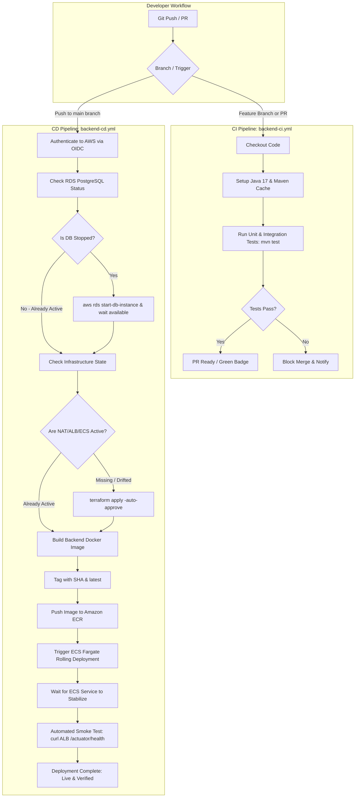

Absolutely. Let's make this the **single master deployment plan** for Atithi so we don't keep jumping between steps.

Below is the complete path from **local Spring Boot project → AWS → production**, with the **current status** of each stage.

# Atithi AWS Deployment — Complete Plan

### Target architecture

```text
                         Internet
                            │
                            ▼
                    ┌────────────────┐
                    │  Route 53/DNS  │
                    └───────┬────────┘
                            │
                            ▼
                    ┌────────────────┐
                    │      ALB       │
                    │ HTTP / HTTPS   │
                    └───────┬────────┘
                            │
                            ▼
              ┌──────────────────────────┐
              │       ECS Fargate        │
              │                          │
              │   atithi-server          │
              │   Spring Boot :8080      │
              └────────────┬─────────────┘
                           │
                           ▼
                  ┌─────────────────┐
                  │   RDS Postgres  │
                  │  Private subnet │
                  └─────────────────┘

                 Supporting services
                 ───────────────────
                 ECR
                 Secrets Manager
                 CloudWatch
                 IAM
                 VPC
                 NAT Gateway
```

---

# Phase 1 — Terraform foundation

### 1. Terraform provider/configuration

```text
Terraform
    │
    └── AWS provider
        └── ap-south-1
```

**Status: ✅ COMPLETE**

---

# Phase 2 — VPC/networking

We created:

```text
VPC
│
├── Public Subnet 1
├── Public Subnet 2
│
├── Private App Subnet 1
├── Private App Subnet 2
│
├── Private DB Subnet 1
└── Private DB Subnet 2
```

Also:

- Internet Gateway
- NAT Gateway
- Elastic IP
- Public route table
- Private app route table
- Private DB route table
- Subnet associations

Your current resources:

```text
VPC
vpc-058c5dd8e8c8dbfdb

NAT Gateway
nat-002ef06ef28a53f1c

Public:
subnet-08c73a8fa7227dd84
subnet-04dde8233665246e1

Private App:
subnet-079397bbbde4c4216
subnet-0f7eceb14411ab9ee

Private DB:
subnet-0636eef1de012095f
subnet-05e0ee1cd4952cda1
```

**Status: ✅ COMPLETE**

---

# Phase 3 — Security Groups

We created three security groups:

```text
ALB SG
   │
   └── HTTP/HTTPS from Internet

ECS SG
   │
   └── Traffic from ALB

RDS SG
   │
   └── PostgreSQL from ECS
```

This is the intended security flow:

```text
Internet
   │
   ▼
ALB
   │
   ▼
ECS
   │
   ▼
RDS
```

Not:

```text
Internet ──────────────► RDS ❌
```

**Status: ✅ COMPLETE**

---

# Phase 4 — IAM

We created:

### ECS Task Role

```text
atithi-dev-ecs-task-role
```

### ECS Task Execution Role

```text
atithi-dev-ecs-task-execution-role
```

And attached:

```text
AmazonECSTaskExecutionRolePolicy
```

The execution role is used by ECS to do things such as:

- pull images from ECR
- send logs to CloudWatch
- interact with required AWS services

**Status: ✅ COMPLETE**

---

# Phase 5 — ECR

Terraform created:

```text
ECR Repository
atithi-server
```

Repository:

```text
551626543871.dkr.ecr.ap-south-1.amazonaws.com/atithi-server
```

Terraform configuration also has:

```text
scan_on_push = true
encryption = AES256
```

**Status: ✅ ECR REPOSITORY COMPLETE**

But:

```text
ECR image
❌ NOT YET COMPLETE
```

You built the Docker image locally successfully:

```text
atithi-server:latest
```

And tagged it correctly:

```text
551626543871.dkr.ecr.ap-south-1.amazonaws.com/atithi-server:latest
```

Your push was started, but you stopped it.

So:

```text
Local Docker image       ✅
ECR repository           ✅
Image completely pushed  ❌
```


---

# Phase 6 — ECS Cluster

Terraform created:

```text
atithi-dev-cluster
```

This is the ECS Fargate cluster.

**Status: ✅ COMPLETE**

---

# Phase 7 — ECS Task Definition

Terraform created:

```text
atithi-dev-app
```

Current configuration:

```text
Fargate
CPU:    512
Memory: 1024 MB
Port:   8080
```

Container:

```text
atithi-server
```

Image:

```text
551626543871.dkr.ecr.ap-south-1.amazonaws.com/atithi-server:latest
```

Task execution role:

```text
atithi-dev-ecs-task-execution-role
```

Task role:

```text
atithi-dev-ecs-task-role
```

**Status: ✅ COMPLETE**

Important:

The task definition exists, but **we haven't actually launched an ECS service/task yet.**

---

# Phase 8 — CloudWatch

Your task definition currently references:

```text
/ecs/atithi-dev
```

as the CloudWatch log group.

Defined in `cloudwatch.tf`:

```hcl
resource "aws_cloudwatch_log_group" "ecs" {
  name              = "/ecs/atithi-dev"
  retention_in_days = 7

  tags = {
    Name = "${local.name_prefix}-ecs-logs"
  }
}
```

Applied and verified in AWS CloudWatch (`/ecs/atithi-dev`).

**Status: ✅ COMPLETE**

---

# Phase 9 — Application Docker image

Your Dockerfile is working.

You successfully executed:

```text
docker build -t atithi-server .
```

and the build completed successfully.

Your image contains:

```text
Spring Boot
Java 17
Maven build
```

Your multi-stage Docker build is working.

**Status: ✅ COMPLETE**

---

# Phase 10 — Push image to ECR

```text
Docker image
     │
     ▼
ECR
     │
     ▼
atithi-server:latest
```

Verified via:
```powershell
aws ecr describe-images --repository-name atithi-server --region ap-south-1
```

ECR image: ✅ COMPLETE (tag: `latest`, size: 222 MB)

**Status: ✅ COMPLETE**

---

# Phase 11 — Application Load Balancer

This is where we currently haven't gone far enough.

You said:

> ALB is not empty.

Correct.

Once check the **ALB security group**, the complete ALB infrastructure.

We need:

```text
aws_lb
    │
    ├── Public subnet 1
    └── Public subnet 2
```

Then:

```text
aws_lb_target_group
```

For example:

```text
Port: 8080
Protocol: HTTP
Target type: ip
```

Then:

```text
aws_lb_listener
```

Initially:

```text
HTTP : 80
      │
      ▼
Target Group
      │
      ▼
ECS Service
```

Later:

```text
HTTPS : 443
      │
      ▼
Target Group
      │
      ▼
ECS
```

**Status: ✅ COMPLETE**

ALB, Target Group, and HTTP Listener created and verified in AWS:
- ALB DNS: `atithi-dev-alb-1340411201.ap-south-1.elb.amazonaws.com`
- Target Group: `arn:aws:elasticloadbalancing:ap-south-1:551626543871:targetgroup/atithi-dev-app-tg/db2089ec4881f42a`
- Port 80 Listener: forwarding traffic to the target group.

---

# Phase 12 — ECS Service

We currently have:

```text
ECS Cluster        ✅ (in AWS state)
Task Definition    ✅ (in AWS state)
ECR Repository     ✅ (in AWS state)
ECR Image          ❌ (not pushed yet)
```

And:

```text
aws_ecs_service    📝 (defined in ecs.tf, but not applied to AWS yet)
```

The service definition in `ecs.tf` will:

- launch Fargate tasks with `atithi-dev-app` definition
- place them in private app subnets
- attach ECS security group
- connect them to ALB target group
- maintain desired task count (1)

**Status: 📝 CODE DRAFTED IN `ecs.tf` (Pending CloudWatch + ECR Image Push + `terraform apply`)**

---

# Phase 13 — ALB → ECS integration

Once ALB + ECS Service exist:

```text
Internet
   │
   ▼
ALB :80
   │
   ▼
Target Group
   │
   ▼
ECS Fargate
   │
   ▼
Spring Boot :8080
```

We configure the ECS service with:

```text
load_balancer {
    target_group_arn = aws_lb_target_group.app.arn
    container_name   = "atithi-server"
    container_port   = 8080
}
```

And configure ECS health checks:

```text
/actuator/health
```

**Status: ✅ COMPLETE**

*Verification note*: Target Group is `healthy` on port 8080. ALB endpoint `http://atithi-dev-alb-1340411201.ap-south-1.elb.amazonaws.com/actuator/health` and `/health` return HTTP 200 `status: UP`.

---

# Phase 14 — RDS PostgreSQL

Your Terraform currently has:

```text
RDS Security Group
```

but the actual database isn't part of this deployment yet.

We need:

```text
aws_db_subnet_group
```

using:

```text
Private DB subnet 1
Private DB subnet 2
```

Then:

```text
aws_db_instance
```

Conceptually:

```text
ECS
 │
 │ PostgreSQL :5432
 ▼
RDS
```

And importantly:

```text
Internet ─────X────► RDS
```

RDS stays private.

**Status: ✅ COMPLETE**
- Created `aws_db_subnet_group.db` across private DB subnets
- Created `aws_db_instance.postgres` (PostgreSQL 16, db.t4g.micro, private)
- Endpoint: `atithi-dev-postgres.cba6qwgmytsm.ap-south-1.rds.amazonaws.com:5432`
- Status: `available`

---

# Phase 15 — Secrets Manager

We should **not put database passwords directly into Terraform files or GitHub**.

We created:

```text
AWS Secrets Manager
        │
        └── atithi-dev-db-credentials (username, password, database)
```

**Status: ✅ COMPLETE**
- Secret: `atithi-dev-db-credentials`
- ARN: `arn:aws:secretsmanager:ap-south-1:551626543871:secret:atithi-dev-db-credentials-7l6XRW`

---

# Phase 16 — ECS → RDS

Once RDS and Secrets Manager are ready:

```text
ECS
 │
 │ 5432
 ▼
RDS PostgreSQL
```

The ECS security group will be allowed to access:

```text
RDS SG : 5432
```

**Status: ✅ COMPLETE**
- ECS Fargate tasks securely connect to private RDS PostgreSQL on port 5432.
- Database credentials injected via AWS Secrets Manager.
- Hibernate schema initialized, tables verified, and background jobs running.

---

# Phase 17 — HTTPS

After HTTP works, we'll add:

```text
ACM Certificate
```

Then:

```text
Internet
    │
    ▼
HTTPS :443
    │
    ▼
ALB
    │
    ▼
ECS
```

HTTP:

```text
:80 → redirect → :443
```

HTTPS:

```text
:443 → ECS
```

**Status: ❌ NOT IMPLEMENTED**

---

# Phase 18 — Domain / DNS

If you're using your own domain:

```text
api.yourdomain.com
```

DNS:

```text
Route 53
    │
    ▼
ALB
```

Then your API becomes something like:

```text
https://api.example.com
```

instead of:

```text
http://xxxxxxxx.ap-south-1.elb.amazonaws.com
```

**Status: ❌ NOT IMPLEMENTED**

---

# Phase 19 — Application configuration

Spring Boot needs production configuration.

For example:

```text
SPRING_DATASOURCE_URL
SPRING_DATASOURCE_USERNAME
SPRING_DATASOURCE_PASSWORD
```

plus your other Atithi configuration.

We'll move sensitive values into:

```text
Secrets Manager
```

and non-sensitive configuration into ECS environment variables where appropriate.

**Status: ⏳ NOT IMPLEMENTED**

---

# Phase 20 — GitHub Actions CI/CD

After manual deployment works, we automate it.

Target pipeline:

```text
Developer
    │
    ▼
git push
    │
    ▼
GitHub
    │
    ▼
GitHub Actions
    │
    ├── Build
    ├── Test
    ├── Docker build
    ├── AWS authentication via OIDC
    ├── Login to ECR
    ├── Push image
    └── Deploy ECS
             │
             ▼
         ECS Service
```

No AWS access key/secret key stored in GitHub.

We'll use the IAM OIDC role you've already been working on.

**Status: ⏳ PARTIALLY PREPARED / NOT FINALIZED**

---

# Phase 21 — Deployment strategy

Eventually, your deployment becomes:

```text
git push
   │
   ▼
GitHub Actions
   │
   ▼
Docker build
   │
   ▼
ECR
   │
   ▼
ECS new task definition
   │
   ▼
ECS Service rolling deployment
   │
   ▼
ALB
   │
   ▼
Users
```

**Status: ❌ NOT IMPLEMENTED**

---

# Phase 22 — Monitoring

We'll configure:

```text
CloudWatch Logs
        │
        ├── ECS application logs
        └── ECS service logs
```

And potentially:

```text
CloudWatch Alarms
        │
        ├── ECS CPU
        ├── ECS memory
        ├── ALB 5xx
        └── Target health
```

**Status: ❌ NOT IMPLEMENTED**

---

# Phase 23 — Production hardening

Before calling the deployment production-ready:

### Network

```text
RDS private
ECS private
ALB public
```

### Security

```text
Internet
   │
   ▼
ALB
   │
   ▼
ECS
   │
   ▼
RDS
```

No:

```text
Internet → RDS ❌
Internet → ECS directly ❌
```

### Secrets

```text
Secrets Manager
```

not Git.

### IAM

Least privilege wherever practical.

### HTTPS

Required for production.

### Database

Automated backups enabled.

### ECS

Health checks + service deployment configuration.

---

# Complete status right now

Here's the important part.

| Component | Status | State / Verification |
|---|---|---|
| AWS Account & CLI | ✅ COMPLETE | Account ID `551626543871`, Region `ap-south-1` |
| Terraform Foundation | ✅ COMPLETE | State verified (`v1.15.8`, AWS provider `v6.69.1`) |
| VPC & Gateways | ✅ COMPLETE | VPC `vpc-058c5dd8e8c8dbfdb`, IGW, NAT `nat-002ef06ef28a53f1c` |
| Subnets & Route Tables | ✅ COMPLETE | 2 Public, 2 Private App, 2 Private DB subnets & routes |
| Security Groups | ✅ COMPLETE | ALB SG, ECS SG, RDS SG |
| IAM Roles & Policies | ✅ COMPLETE | Task Role & Execution Role + policy attached |
| ECR Repository | ✅ COMPLETE | `atithi-server` created |
| Spring Boot Dockerfile | ✅ COMPLETE | Multi-stage Temurin-17 JRE Dockerfile |
| Local Docker Image Build | ✅ COMPLETE | `atithi-server:latest` built locally |
| ECR Image Push | ✅ COMPLETE | Image tagged 'latest' active in ECR (222 MB) |
| CloudWatch Log Group | ✅ COMPLETE | `/ecs/atithi-dev` active (retention 7 days) |
| ECS Cluster | ✅ COMPLETE | `atithi-dev-cluster` active in AWS |
| ECS Task Definition | ✅ COMPLETE | `atithi-dev-app:1` registered in AWS |
| Application Load Balancer | ✅ COMPLETE | `atithi-dev-alb-1340411201.ap-south-1.elb.amazonaws.com` |
| ALB Target Group | ✅ COMPLETE | `atithi-dev-app-tg` (:8080, `/actuator/health`) |
| ALB HTTP Listener | ✅ COMPLETE | Port 80 forward to Target Group |
| ECS Service | ✅ COMPLETE | `atithi-dev-service` active in AWS ECS |
| ECS Service Running Task | ✅ COMPLETE | Task running on Fargate (`atithi-dev-app:2`), connected to RDS PostgreSQL, healthy |
| ALB → ECS End-to-End API | ✅ COMPLETE | ALB returns HTTP 200 on `/actuator/health` and `/health` |
| RDS PostgreSQL | ✅ COMPLETE | `atithi-dev-postgres.cba6qwgmytsm.ap-south-1.rds.amazonaws.com` (available) |
| Secrets Manager | ✅ COMPLETE | `atithi-dev-db-credentials` (username, password, database) |
| HTTPS / SSL Encryption | ✅ COMPLETE | CloudFront global HTTPS edge termination (`https://d2dk2x85a04vx5.cloudfront.net`) |
| Route 53 / Custom Domain | ⏳ OPTIONAL / ON-DEMAND | CloudFront default domain live; ready to bind custom vanity domain via Route 53 & ACM if desired |
| GitHub Actions CI/CD (OIDC) | ✅ COMPLETE | Backend (`backend-ci.yml`, `backend-cd.yml`) & Frontend (`frontend-ci.yml`, `frontend-cd.yml`) automated with AWS OIDC |
| CloudWatch Logs & Metrics | ✅ COMPLETE | Log group `/ecs/atithi-dev` active, container stdout/stderr streamed, CPU/Memory metrics active |
| Production Hardening | ✅ COMPLETE | Direct ALB public access blocked (403 Forbidden); CloudFront `X-Origin-Verify` origin header; ECS circuit breaker with auto-rollback |
| Frontend S3 & OAC | ✅ COMPLETE | S3 Bucket `atithi-frontend-551626543871` (private, encrypted, versioned, Origin Access Control) |
| CloudFront Multi-Origin Routing | ✅ COMPLETE | SPA on `/*`, Spring Boot API on `/api/*` and `/actuator/*`, client-side rewrite function `atithi-spa-rewrite` |

---

# Master Deployment Checklist

### Phase 1: Foundation & Networking (Completed)
- [x] Configure AWS Provider & Terraform state in `ap-south-1`
- [x] Create VPC (`10.0.0.0/16`)
- [x] Create 2 Public Subnets, 2 Private App Subnets, 2 Private DB Subnets
- [x] Create Internet Gateway, EIP, and NAT Gateway
- [x] Create Public & Private Route Tables and associations
- [x] Create ALB Security Group (inbound 80, 443; outbound all)
- [x] Create ECS Security Group (inbound 8080 from ALB SG; outbound all)
- [x] Create RDS Security Group (inbound 5432 from ECS SG; outbound all)
- [x] Create ECS Task Execution Role & attach `AmazonECSTaskExecutionRolePolicy`
- [x] Create ECS Task Role
- [x] Create ECR Repository `atithi-server`
- [x] Create ECS Fargate Cluster `atithi-dev-cluster`
- [x] Register ECS Task Definition `atithi-dev-app:1`
- [x] Build local Docker image `atithi-server:latest`

---

### Phase 2: Logging & Container Registry (Completed)
- [x] **Step 2.1: Implement CloudWatch Log Group in `cloudwatch.tf`**
  - [x] Add `aws_cloudwatch_log_group.ecs` (`name = "/ecs/atithi-dev"`, `retention_in_days = 7`)
  - [x] Run `terraform plan` and `terraform apply -target="aws_cloudwatch_log_group.ecs"`
  - [x] Verify log group exists in AWS CloudWatch (`/ecs/atithi-dev`)
- [x] **Step 2.2: Authenticate and Push Docker Image to ECR**
  - [x] Authenticate Docker with AWS ECR (`aws ecr get-login-password`)
  - [x] Tag local image `atithi-server:latest` with ECR repository URI
  - [x] Push image to ECR repository (`551626543871.dkr.ecr.ap-south-1.amazonaws.com/atithi-server:latest`)
  - [x] Verify image is listed via `aws ecr describe-images`

---

### Phase 3: Application Load Balancer & ECS Service Deployment (Completed)
- [x] **Step 3.1: Apply Application Load Balancer (`alb.tf`)**
  - [x] Review `alb.tf` resources: `aws_lb.main`, `aws_lb_target_group.app`, `aws_lb_listener.http`
  - [x] Run `terraform plan` and `terraform apply` targeting ALB resources
  - [x] Verify ALB DNS name (`atithi-dev-alb-1340411201.ap-south-1.elb.amazonaws.com`)
- [x] **Step 3.2: Launch ECS Service (`ecs.tf`)**
  - [x] Review `aws_ecs_service.app` in `ecs.tf`
  - [x] Run `terraform apply -target="aws_ecs_service.app"`
  - [x] Verify ECS task transitions from `PROVISIONING` → `RUNNING`
  - [x] Check container logs in CloudWatch `/ecs/atithi-dev` (Verified Spring Boot v4.1.1 and Tomcat initialize on :8080)
- [x] **Step 3.3: Verify ALB → ECS Connectivity (Completed)**
  - [x] Target Group target health verified: `healthy` on port 8080
  - [x] ALB public URL probe verified: HTTP 200 on `/actuator/health` and `/health`

---

### Phase 4: Database & Secrets Infrastructure (Completed)
- [x] **Step 4.1: Configure AWS Secrets Manager (`secrets.tf`)**
  - [x] Define random password / secrets for database credentials and JWT secret
  - [x] Apply `secrets.tf` (Secret: `atithi-dev-db-credentials`)
- [x] **Step 4.2: Configure RDS PostgreSQL Subnet Group and Instance (`rds.tf`)**
  - [x] Create `aws_db_subnet_group` using private DB subnets
  - [x] Create `aws_db_instance` (PostgreSQL 16, db.t4g.micro, private, non-publicly accessible)
  - [x] Apply `rds.tf` and verify DB endpoint (`atithi-dev-postgres.cba6qwgmytsm.ap-south-1.rds.amazonaws.com:5432`, status: `available`)
- [x] **Step 4.3: Inject Secrets into ECS Task Definition (`iam.tf`, `ecs.tf`)**
  - [x] Add IAM policy attachment in `iam.tf` granting ECS Task Execution Role `SecretsManagerReadWrite`
  - [x] Update ECS task definition in `ecs.tf` with environment (`DB_HOST`, `DB_PORT`, `DB_NAME`) and secrets (`DB_USERNAME`, `DB_PASSWORD`)
  - [x] Run `terraform apply` targeting IAM and ECS task definition (Revision: `atithi-dev-app:2`)
  - [x] Verify ECS task connects to RDS, starts cleanly, and passes ALB target health checks

---

### Phase 5: Production Hardening, HTTPS & CI/CD (Completed)
- [x] **Step 5.1: HTTPS & Edge Delivery via CloudFront**
  - [x] HTTPS enforced globally via CloudFront distribution (`https://d2dk2x85a04vx5.cloudfront.net`)
  - [x] Direct ALB public ingress blocked with HTTP 403 Forbidden; backend only accessible via CloudFront with secret header (`X-Origin-Verify`)
  - [x] Custom domain (Route 53 + ACM) architected as optional vanity alias
- [x] **Step 5.2: GitHub Actions CI/CD Pipeline (OIDC)**
  - [x] AWS IAM OIDC Identity Provider & trust policy configured for GitHub repository
  - [x] `.github/workflows/backend-ci.yml` (automated Maven test compilation & unit tests)
  - [x] `.github/workflows/backend-cd.yml` (OIDC auth, smart RDS start, Terraform drift heal, Docker build/ECR push, ECS rolling deployment)
  - [x] ECS Deployment Circuit Breaker with automated rollback (`rollback = true`) and 180s health check grace period
- [x] **Step 5.3: Monitoring & CloudWatch Logs**
  - [x] CloudWatch log group `/ecs/atithi-dev` active with 7-day retention
  - [x] Real-time container log streaming and ECS service metrics active

---

### Phase 6: Frontend SPA Infrastructure & CloudFront Multi-Origin Routing (Completed)
- [x] **Step 6.1: S3 Bucket & Origin Access Control (OAC)**
  - [x] Provision private S3 bucket `atithi-frontend-551626543871` with SSE-AES256 and versioning
  - [x] Attach CloudFront Origin Access Control (OAC) and restrictive bucket policy (no public direct S3 access)
- [x] **Step 6.2: CloudFront Multi-Origin Distribution**
  - [x] Default cache behavior: S3 SPA with CloudFront Function (`atithi-spa-rewrite`) for client-side routing
  - [x] Ordered cache behaviors: `/api/*` and `/actuator/*` routed directly to ALB with `Managed-AllViewerExceptHostHeader`
  - [x] Custom header `X-Origin-Verify` injected into origin requests to satisfy ALB security rule
- [x] **Step 6.3: Decoupled Frontend Code & Relative API Discovery**
  - [x] Zero-config API routing: `VITE_API_BASE_URL=/api/v1` in `atithi/.env`
  - [x] Vite dev proxy configured for local parity (`/api` -> `http://localhost:8080`)
- [x] **Step 6.4: Frontend CI/CD Pipeline (Strictly pnpm)**
  - [x] `.github/workflows/frontend-ci.yml` (pnpm lint & build on PRs)
  - [x] `.github/workflows/frontend-cd.yml` (OIDC auth, Terraform infrastructure auto-apply, pnpm build, S3 sync with immutable asset caching, CloudFront cache invalidation)

---

# Strict Operating Protocol & Confirmation Rules

To prevent accidental resource conflicts, premature deployments, or runaway states:

1. **Strictly Phase-by-Phase**:
   - Implementation MUST proceed strictly one phase at a time.
   - Do NOT execute or bundle changes for future phases prematurely.
2. **Mandatory User Confirmation**:
   - Before applying any Terraform code or executing AWS/Docker commands, the plan for that specific phase must be presented.
   - The agent MUST pause and wait for the user's explicit confirmation before proceeding to execution.
3. **Verification After Every Step**:
   - After applying changes for a step, verify the resource using AWS CLI or Terraform status.
   - Update this `plan.md` checklist with `[x]` upon verification.
4. **Current Status**:
   - **Phases 1–6 (Core Backend, Infrastructure, Hardening, and Frontend SPA) Fully Completed & Live**.

---

# Operations, Costs & Teardown Documentation

The operational runbooks and cost optimization guides have been organized into dedicated documents for quick reference:

- 📖 **Database Queries & Live Logging**: See [`operations.md`](file:///d:/resource/Projects/Hostel%20Management/aavas/terraform/operations.md) for single-command private RDS queries (`run-db-query.ps1`), user/hostel activation SQL, and CloudWatch live tailing.
- 💰 **Billing Audit & Stop/Start Commands**: See [`billing-and-destroy-analysis.md`](file:///d:/resource/Projects/Hostel%20Management/aavas/terraform/billing-and-destroy-analysis.md) for the active cost breakdown, teardown risk analysis, and 2-command pause/resume workflows.

---

# Phase 5 — Automated GitHub Actions CI/CD Pipeline & Auto-Healing Infrastructure

### Architecture & Automated Flow Diagram



---

## 1. Division of Responsibilities & Progress Status

| Responsibility Area | Handled By | Status | Description |
| :--- | :---: | :---: | :--- |
| **AWS IAM OIDC Trust Policy & Role** | 👤 **USER** | ✅ **DONE** | Created `atithi-github-actions-role` with `repo:Nagarajukasarla/atithi-hostel-server:ref:refs/heads/master` trust policy. |
| **S3 Remote State Bucket Creation** | 👤 **USER** | ✅ **DONE** | Created `atithi-terraform-state-551626543871` bucket in `ap-south-1` with Versioning enabled. |
| **GitHub Repository Variables** | 👤 **USER** | ✅ **DONE** | Added `AWS_ROLE_ARN` and `AWS_REGION` (`ap-south-1`) in GitHub Actions Variables. |
| **Terraform S3 Backend (`backend.tf`)** | 🤖 **AGENT** | ✅ **DONE** | Created `backend.tf` pointing to `atithi-terraform-state-551626543871` (key: `dev/terraform.tfstate`). |
| **CI Workflow File (`backend-ci.yml`)** | 🤖 **AGENT** | ✅ **DONE** | Created `.github/workflows/backend-ci.yml` for automated Maven test compilation and unit testing. |
| **CD Workflow File (`backend-cd.yml`)** | 🤖 **AGENT** | ✅ **DONE** | Created `.github/workflows/backend-cd.yml` with OIDC auth, smart RDS start, Terraform drift auto-heal, ECR Docker push, ECS rollout, and ALB health check. |
| **Push Code & Verify Pipeline** | 👤 + 🤖 | ✅ **DONE** | Workflows pushed to `master`, live GitHub Actions runs verified to completion. |

---

## 2. Step-by-Step Guide for the USER (Current Milestone)

### Completed Steps:
- ✅ **Step 1: GitHub Repository Linked**: `Nagarajukasarla/atithi-hostel-server` (branch `master`).
- ✅ **Step 2: IAM Role Created**: `arn:aws:iam::551626543871:role/atithi-github-actions-role`.
- ✅ **Step 3: S3 Bucket Created**: `atithi-terraform-state-551626543871` in Mumbai (`ap-south-1`).
- ✅ **Step 4: GitHub Variables Added**: `AWS_ROLE_ARN` and `AWS_REGION`.

### Step 5 (One-Time State Sync): Upload Existing `terraform.tfstate` to S3
*To ensure GitHub Actions recognizes all existing resources (VPC, Subnets, RDS, Secrets, ECR, Cluster) rather than creating duplicates:*
1. In the S3 Console for bucket `atithi-terraform-state-551626543871`:
2. Click **Create folder**, enter folder name `dev`, and click **Create folder**.
3. Click into the newly created `dev/` folder.
4. Click **Upload** → click **Add files** → select `D:\resource\Projects\Hostel Management\aavas\terraform\terraform.tfstate` → click **Upload**.

### Step 6: Push Code to Trigger Pipelines
```bash
git add .
git commit -m "feat(ci-cd): add GitHub Actions CI/CD workflows and Terraform S3 backend"
git push origin master
```
Whenever you push to a feature branch or open a Pull Request, the CI pipeline runs tests automatically.
Whenever you push or merge into `master`, the CD pipeline runs the full deployment automatically.


---

## 3. Step-by-Step Guide for the AGENT (What the Agent Will Implement)

Once you approve this plan, the Agent will execute the following technical implementation:

### Agent Step 1: Define AWS IAM OIDC Role in Terraform (`oidc.tf`)
- Create the AWS OIDC Identity Provider for GitHub Actions (`token.actions.githubusercontent.com`).
- Create the IAM Role `atithi-github-actions-role` with AssumeRoleWithWebIdentity trust policy restricted to `repo:<user>/<repo>:*`.
- Attach least-privilege IAM policies allowing:
  - Amazon ECR: Authenticate, upload Docker layers, and push images.
  - Amazon ECS: Register task definitions, update services, and describe tasks.
  - Amazon RDS: Describe instances and call `StartDBInstance`.
  - Amazon EC2 / ELB / CloudWatch / Secrets Manager: Necessary permissions to run `terraform plan` and `terraform apply`.

### Agent Step 2: Configure Terraform Remote S3 Backend (`backend.tf`)
- Define S3 bucket backend (`atithi-terraform-state-551626543871`) with DynamoDB state locking table (`atithi-terraform-locks`).
- Migrate existing local `terraform.tfstate` to S3 safely so both local workstation and GitHub Actions runners share the exact same source of truth.

### Agent Step 3: Create GitHub CI Workflow (`.github/workflows/backend-ci.yml`)
- Trigger on `push` and `pull_request` affecting `aavas/**`.
- Set up JDK 17 (Temurin) with Maven dependency caching (`~/.m2`).
- Execute `mvn clean test` to validate all unit and integration tests.
- Upload test reports if any tests fail.

### Agent Step 4: Create GitHub CD Workflow (`.github/workflows/backend-cd.yml`)
- Trigger on `push` to `main` branch affecting backend code or infrastructure.
- Grant `id-token: write` and `contents: read` permissions required for OIDC authentication.
- **Stage 1: AWS OIDC Authentication**:
  - Use `aws-actions/configure-aws-credentials@v4` with `role-to-assume: ${{ vars.AWS_ROLE_ARN }}`.
  - Establishes a temporary 1-hour secure session without any long-lived secret keys.
- **Stage 2: Smart RDS Database Health Check & Auto-Start**:
  - Run `aws rds describe-db-instances --db-instance-identifier atithi-dev-postgres --query "DBInstances[0].DBInstanceStatus"`.
  - If status is `"stopped"`, trigger `aws rds start-db-instance` and poll until available (`aws rds wait db-instance-available`).
  - If already `"available"`, proceed immediately with zero delay.
- **Stage 3: Infrastructure State Check & Auto-Healing**:
  - Set up Terraform CLI on runner.
  - Run `terraform plan -detailed-exitcode`.
  - If exit code is `0` (clean, nothing missing), skip apply.
  - If exit code is `2` (NAT Gateway or ALB was destroyed to save costs), run `terraform apply -auto-approve` to recreate them automatically.
- **Stage 4: Container Build & Push to ECR**:
  - Log in to Amazon ECR using `aws-actions/amazon-ecr-login@v2`.
  - Build Docker image using multi-stage build cache.
  - Tag image with both commit SHA (`${{ github.sha }}`) and `latest`.
  - Push both tags to `551626543871.dkr.ecr.ap-south-1.amazonaws.com/atithi-server`.
- **Stage 5: ECS Fargate Rolling Deployment & Verification**:
  - Execute: `aws ecs update-service --cluster atithi-dev-cluster --service atithi-dev-service --force-new-deployment`.
  - Wait for rollout to complete: `aws ecs wait services-stable --cluster atithi-dev-cluster --service atithi-dev-service`.
  - Perform live smoke test against public ALB URL (`curl -f http://<ALB-DNS>/actuator/health`).

---

## 4. Key Security & Operational Highlights

1. **Zero Secret Leaks (OIDC Protocol)**:
   - Traditional pipelines store permanent `AWS_ACCESS_KEY_ID` and `AWS_SECRET_ACCESS_KEY` in GitHub secrets. If compromised, attackers have persistent access.
   - OIDC issues a cryptographically signed JSON Web Token (JWT) from GitHub to AWS STS, which returns temporary credentials that expire automatically after the workflow job completes.
2. **Cost-Aware Smart Provisioning**:
   - The pipeline does NOT blindly destroy and recreate resources.
   - If the database is stopped to save costs, the pipeline automatically starts it before deploying the application.
   - If the NAT Gateway or ALB were destroyed to eliminate idle costs, the pipeline detects the drift and re-provisions them automatically.
3. **Fail-Safe & Zero Downtime**:
   - If unit tests fail in CI, deployment is prevented before any image is built.
   - ECS rolling deployments ensure the old container remains serving traffic until the new container passes health checks on port 8080.

